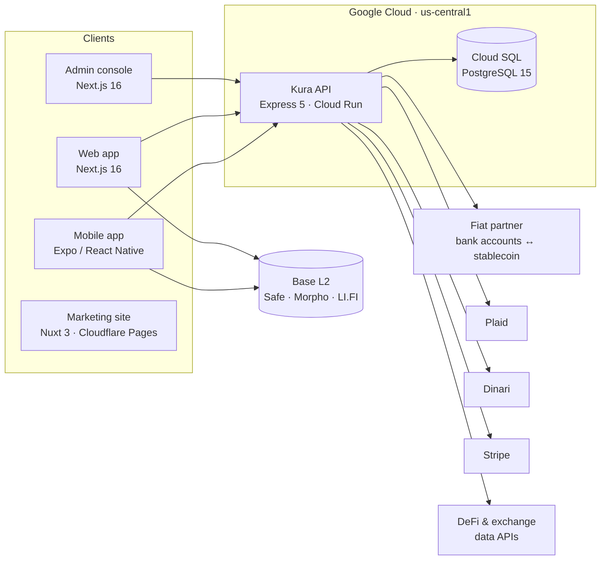

# Kura Finance

**The Super Financial App** — Trade, spend, and track your entire financial life in one self-custody app.

**English** · [中文](#中文)

> [!NOTE]
> **Kura Finance LLC has wound down operations (2026).** The product code is published under the MIT license (© Prism Capital LLC) as a reference implementation. Existing users can export their wallet keys through [Privy](https://home.privy.io). Forks need their own banking, brokerage and data-provider contracts, licenses and KYC programs.

---

## English

## One App. Every Financial Move.

Stop juggling a wallet, an exchange, a brokerage, a card, and a spreadsheet.

**Kura** brings trading, spending, and tracking together in one super app — while you keep custody of your keys and your data.

| Wallet | Card | Trading | Tracking |
|--------|------|---------|----------|
| Self-custody smart wallet | Non-custodial Kura Card | Crypto, RWA & US stocks | TrackFi unified dashboard |

### Trade crypto and US stocks from one wallet
- Swap tokens on Base, bridge across chains
- Access tokenized real-world assets and US equities
- No separate exchange or brokerage — your keys, your trades, your portfolio

### Move money globally
- Personal bank details in USD, EUR, GBP, MXN and BRL
- Deposits convert to stablecoins automatically; withdraw back to a bank account
- Coverage across the US, EU, UK, Mexico and Brazil

### Spend with Kura Card
- Spend USDC anywhere Visa is accepted
- Non-custodial card backed by your own wallet
- No top-up to a custodian, no surrendering custody

### Track everything with TrackFi
- Connect banks, brokers, and on-chain wallets with read-only access
- See your full net worth in one passkey-encrypted dashboard
- Zero-Access design — your data stays inaccessible without your authorization

---

## Business Report

### 1. Executive summary

Kura was a consumer fintech super app built around one idea: **you keep custody of your money and your data**. A single account let users hold stablecoins in a self-custody smart wallet, move money in and out of bank accounts in five regions, buy tokenized US stocks, earn DeFi yield, and see their full net worth across banks, brokers, exchanges and wallets. The server could not decrypt any of that financial data.

| | |
|---|---|
| **Operating period** | April – September 2026 (≈ 5 months from first commit to wind-down) |
| **Team** | Solo founder-engineer |
| **Platforms** | iOS & Android app, web app, internal ops console, marketing site |
| **Codebase** | ≈ 148K lines of TypeScript across 5 repositories |
| **Users in KYC** | 249 onboarded · 68 approved · 18 funded |
| **Gross deposits** | ≈ US$34K across USD, EUR, MXN and GBP · ≈ US$18.3K (54%) refunded |
| **Revenue** | 381.32 USDC in ramp fees · US$0 from subscriptions |
| **Where users came from** | Southeast Asia 46% · Latin America 18% · Africa 17% · Europe 12% · US 1% |
| **Fiat coverage** | US (ACH/wire), EU (SEPA), UK (Faster Payments), Mexico (SPEI), Brazil (PIX) |

### 2. Problem

People who hold both traditional and on-chain assets juggle a bank app, a crypto exchange, a brokerage, a card and a spreadsheet. Each one holds custody of their money, their data, or both. The tools that aggregate it all (budgeting and net-worth apps) store complete financial histories in plaintext on their servers.

### 3. Product

| Product | What it does |
|---|---|
| [**Kura Wallet**](https://kura-finance.com/kura-wallet) | Safe smart account on Base (ERC-4337). Log in with Privy; pay gas in USDC via Pimlico; swap and bridge via LI.FI; works as a WalletConnect wallet for dApps |
| [**Financial Account**](https://kura-finance.com/financial-account) | Personal virtual bank accounts (USD, EUR, GBP, MXN, BRL) through a regulated fiat partner. Deposits auto-convert to stablecoins; payouts go back to bank accounts |
| [**RWA & US Stocks**](https://kura-finance.com/us-stocks) | Tokenized US equities (Dinari dShares) settled on Base, with managed KYC |
| [**Earn / Borrow**](https://kura-finance.com/earn) | Morpho vaults and markets on Base |
| [**TrackFi**](https://kura-finance.com/trackfi) | Net-worth dashboard across banks and brokers (Plaid), 8 centralized exchanges and DeFi positions. End-to-end encrypted with passkeys |
| [**Business & Team**](https://kura-finance.com/business) | Organization treasuries on Safe multisig: propose → approve → execute, team and threshold management, activity reports |
| [**Kura Card**](https://kura-finance.com/kura-card) | Non-custodial USDC Visa card (waitlist; card partners were evaluated but the card never launched) |

### 4. Business model

| Stream | Mechanism |
|---|---|
| Subscriptions (Stripe) | **Basic** free · **Pro** $12.99/mo or $129.99/yr · **Ultimate** $29.99/mo or $299.99/yr |
| On/off-ramp | Kura margin of 0.25% on top of the partner's wholesale cost, computed server-side |
| Swaps & bridges | LI.FI integrator fee, 0.25% |
| Earn | Morpho fee-wrapper vaults, 10% performance fee |
| Referrals | Cashback program settled from ramp events |

All revenue flowed into one idempotent ledger (`PlatformRecord`) that fed an investor-metrics dashboard.

### 5. Operating data (full disclosure, as of 30 Oct 2026)

**Users and KYC**

| Status | Users |
|---|---|
| Approved | 68 |
| Rejected | 64 |
| Paused | 16 |
| Incomplete | 9 |
| Not started | 92 |
| **Total** | **249** (248 individuals, 1 business) |

| Month (2026) | Jun | Jul | Aug | Sep | Oct* |
|---|---|---|---|---|---|
| New users | 8 | 83 | 50 | 2 | 106 |

\* October sign-ups came after the shutdown notice.

**Users by region** (country of residence; 94 users who never started KYC have no country on file)

| Region | All users with a country (155) | Approved users (68) |
|---|---|---|
| Southeast Asia | 71 (45.8%) | 27 (39.7%) |
| Latin America | 28 (18.1%) | 10 (14.7%) |
| Africa | 27 (17.4%) | 13 (19.1%) |
| Europe | 18 (11.6%) | 11 (16.2%) |
| Other Asia | 7 (4.5%) | 4 (5.9%) |
| North America | 3 (1.9%) | 2 (2.9%) |
| Oceania | 1 (0.6%) | 0 |
| Unknown | — | 1 (1.5%) |

| Country | All users (% of 155) | Approved (% of 68) |
|---|---|---|
| Indonesia | 36 (23.2%) | 12 (17.6%) |
| Philippines | 30 (19.4%) | 13 (19.1%) |
| Nigeria | 13 (8.4%) | 6 (8.8%) |
| Egypt | 7 (4.5%) | 5 (7.4%) |
| Mexico | 7 (4.5%) | 1 (1.5%) |
| Brazil | 7 (4.5%) | 2 (2.9%) |
| Chile | 6 (3.9%) | 2 (2.9%) |
| South Africa | 5 (3.2%) | 2 (2.9%) |
| India · Spain · Colombia · Hong Kong | 3 each (1.9%) | 2 each (2.9%) |
| United States | 2 (1.3%) | 1 (1.5%) |
| 26 other countries | 1–2 each | 0–1 each |

**Approved payment rails** (users): US 78 · EU/SEPA 78 · UK Faster Payments 44 · Mexico SPEI 27 · Brazil PIX 25 (PIX payouts 25, PIX deposits 3)

**Deposits (virtual bank accounts)**

- **182** virtual accounts issued; **18** users funded them, with **75** deposits in total

| Currency | Gross deposits |
|---|---|
| USD | 27,067.57 |
| MXN | 37,208.34 (≈ US$2.0K) |
| EUR | 4,208.18 (≈ US$4.5K) |
| GBP | 285.29 (≈ US$0.4K) |
| **Total** | **≈ US$34K** |

| Month (2026) | Jul | Aug | Oct* |
|---|---|---|---|
| Deposits | 15 | 8 | 52 |

\* October deposits arrived after the shutdown notice.

Deposit lifecycle events: 54 converted and paid out to wallets · 21 held for review · 21 refunded · 18 refunds in flight · 11 scheduled · 25 account deactivations

**Payouts and crypto deposits**: 13 payout/deposit addresses; 6 completed transactions totaling 67.66 USDT + 11.50 USDC from 3 users.

**Refunds** (deposits returned to the sender)

| Currency | Refunded | Share of gross deposits |
|---|---|---|
| USD | 17,123.00 | 63% |
| EUR | 904.64 (≈ US$1.0K) | 21% |
| MXN | 4,400.00 (≈ US$0.2K) | 12% |
| GBP | 5.00 | 2% |
| **Total** | **≈ US$18.3K** | **≈ 54%** |

21 deposits were refunded; refunds still in flight at the time of the snapshot are not counted separately because they overlap with the completed ones. Net deposits kept on the platform: **≈ US$15.6K**.

**Revenue**

| Source | Amount |
|---|---|
| Fiat-ramp fees (on 54 converted deposits) | **381.32 USDC** |
| Subscriptions (Stripe, live mode) | **US$0**: 3 Pro monthly subscriptions, all invoiced at $0 (full discount or trial), all later canceled; no charges, refunds or disputes |
| Swap / Earn fees (LI.FI, Morpho) | Not measured in this report |

**Expenses**

- **Wire-return fees** on refunded deposits exceeded the 381.32 USDC of ramp fees. **Net fiat-ramp revenue was negative.**
- Fixed monthly fees for each open virtual account, plus cloud hosting (Google Cloud Run and Cloud SQL) and third-party API subscriptions. These are not itemized in this report.

**Risk**: one fraud incident (≈ 992.5 USDC, 27 Jul 2026), traced on-chain and remediated. It led to the recall, suspension and fraud-rate monitoring tooling described below.

**Infrastructure**

| Metric | Value |
|---|---|
| Production deploys | 519 (API 294 · web 216 · admin 9) |
| API requests, Sep–Oct 2026 | ≈ 131K (web 24K · admin 12.7K) |
| Database size | ≈ 90 MB (PostgreSQL) |

### 6. Technology

| Layer | Stack | Scale |
|---|---|---|
| **API** | Node 24, TypeScript 6 (strict), Express 5, Prisma 6, PostgreSQL 15, zod | ~28K LOC · ~127 endpoints · 20 domains · 35 models · 75 migrations |
| **Mobile** | Expo SDK 54, React Native 0.81 (New Architecture), Zustand, i18next (EN / 繁中), Vitest | ~74K LOC · 27 screens |
| **Web** | Next.js 16, React 19, Tailwind 4, TanStack Query, wagmi / viem, Reown | ~31K LOC · 35 routes |
| **Admin** | Next.js 16, Privy auth, admin allowlist | ~4.7K LOC |
| **Marketing** | Nuxt 3, @nuxt/content, Cloudflare Pages | ~10K LOC · ~44 pages |
| **Infra** | GitHub Actions → Docker → GCR → Cloud Run; Prisma migrations through Cloud SQL Auth Proxy before every deploy | 519 production revisions |

**Engineering highlights**

- **Zero-Access E2EE.** Each sync generates an AES-256-GCM session key, sealed to the user's X25519 public key (libsodium sealed box) and then zeroized. The private key is wrapped by a key derived from the passkey's **WebAuthn PRF** output, so the server cannot decrypt user financial data. It was rolled out in three migration phases, with a key-reset flow for lost passkeys.
- **Fiat rails** (the largest domain, ~4.6K LOC): KYC with per-rail endorsements, virtual accounts, payout addresses, Tron USDT → Base USDC deposits, external bank accounts (US / IBAN / CLABE / PIX / GB), and funds recalls. Webhooks use RSA signature verification, a 10-minute replay window, fail-closed behavior and event deduplication. Every outbound request carries an idempotency key.
- **Risk operations.** Fraud remediation (recalls, returns, account suspension), a monthly fraud-rate monitor against partner thresholds, and an inactive-account sweeper to avoid per-account fees.
- **Modular monolith.** 15 feature-flagged domains; disabled domains skip env validation and unmount their routes. Tiered rate limits and per-plan sync quotas.

### 7. Timeline

| Date | Milestone |
|---|---|
| Apr 2026 | GCP project, API and Cloud SQL go live; web app deployed |
| May 2026 | Mobile app development begins |
| Jun 2026 | First fiat-account customers; on/off-ramp live |
| Jul 2026 | Public launch; peak sign-ups (83); marketing site rebuilt; fraud incident and risk tooling |
| Aug 2026 | Internal admin console; Business & Team treasuries |
| Sep 2026 | Development stops; code relicensed under MIT and open-sourced |
| Oct 2026 | Shutdown notice published; wallet-only maintenance |

### 8. Why it stopped — lessons learned

1. **Too broad, too early.** Wallet, card, stocks, DeFi, aggregation and business treasuries all shipped before a single wedge found product-market fit. The card alone went through three partner approaches without launching.
2. **The ramp margin could not absorb returns.** Ramp fees earned 381.32 USDC on ≈ US$34K of gross deposits, but ≈ 54% of that money was sent back, and the wire-return fees on those refunds **wiped out all fiat-ramp revenue**. A thin percentage fee needs either volume or pass-through of return costs; Kura had neither.
3. **Regulated money movement is an operations business.** KYC rejections (64 of 249), fraud-rate thresholds, recalls, refunds and per-account fees demand dedicated compliance capacity that a solo founder cannot sustain next to engineering.
4. **Activation is the real funnel.** 249 KYC starts → 68 approved → 18 funded. Onboarding friction, not features, was the constraint.
5. **The users were not the ones we designed for.** The product was built for US-style multi-asset users, but 81% of users came from Southeast Asia, Latin America and Africa, looking for USD and EUR receiving accounts. Only 2 were in the US. Cross-border wires into those accounts are the likely cause of the high refund rate.
6. **Subscriptions were never validated.** No one paid for Pro or Ultimate; the 3 Pro subscriptions were all invoiced at $0.
7. **What worked:** shipping speed (519 production deploys), a security architecture that holds up to scrutiny, and a clean, documented codebase that others can fork.

### 9. Repositories

| Repository | Description | License |
|---|---|---|
| [BackendServer](https://github.com/Kura-Finance/BackendServer) | API: auth, fiat rails, Plaid, Dinari, Stripe, treasuries, E2EE | MIT |
| [mobile-app](https://github.com/Kura-Finance/mobile-app) | iOS / Android self-custody wallet (Expo) | MIT |
| [WebClients](https://github.com/Kura-Finance/WebClients) | Web app: wallet, treasuries, TrackFi, Earn / Borrow | MIT |
| [LandingPage](https://github.com/Kura-Finance/LandingPage) | Marketing site and blog (Nuxt 3) | All rights reserved |

Each repository has its own architecture, security and threat-model documentation.

### 10. Explore

- [Pricing](https://kura-finance.com/pricing)
- [Download](https://kura-finance.com/download)
- [Documentation](https://kura-finance.com/docs) — supported regions for stocks, cards, and on/off-ramps
- [Blog](https://kura-finance.com/blog)
- [About](https://kura-finance.com/about)
- [Community](https://kura-finance.com/community)
- [Help](https://kura-finance.com/help)

Built by **Rick Weng** — [@rickwengdev](https://github.com/rickwengdev). Security reports: security@kura-finance.com.

---

## 中文

## 一個 App，搞定所有金融操作

不用再在錢包、交易所、券商、信用卡和試算表之間來回切換。

**Kura** 把交易、消費和追蹤整合進一個超級 App，而私鑰和資料始終由你自己掌握。

| 錢包 | 卡片 | 交易 | 追蹤 |
|------|------|------|------|
| 自託管智慧錢包 | 非託管 Kura Card | 加密貨幣、RWA 與美股 | TrackFi 整合儀表板 |

### 一個錢包交易加密貨幣和美股
- 在 Base 上 swap 代幣、跨鏈轉帳
- 投資 tokenized 現實世界資產和美股
- 不需要另外開交易所或券商帳戶，私鑰、交易和投資組合都是你的

### 全球收付款
- 個人專屬 USD、EUR、GBP、MXN、BRL 銀行帳戶資訊
- 入金自動換成穩定幣，也能出金回銀行帳戶
- 支援美國、歐盟、英國、墨西哥、巴西

### 用 Kura Card 消費
- 在任何接受 Visa 的地方刷 USDC
- 非託管卡片，背後是你自己的錢包
- 不用先儲值給託管方，也不用交出資產控制權

### 用 TrackFi 追蹤一切
- 以唯讀權限連結銀行、券商和鏈上錢包
- 在一個以 passkey 加密的儀表板看到完整淨資產
- Zero-Access 設計：沒有你的授權，任何人都無法存取你的資料

---

## 商業報告

### 1. 摘要

Kura 是一個消費者金融超級 App，核心理念是**錢和資料都由使用者自己掌握**。一個帳戶就能做到：用自託管的智慧錢包持有穩定幣、在五個地區和銀行之間出入金、買 tokenized 美股、賺 DeFi 收益，以及查看橫跨銀行、券商、交易所和錢包的完整淨資產。伺服器無法解密任何一筆財務資料。

| | |
|---|---|
| **營運期間** | 2026 年 4 月 – 9 月（從第一個 commit 到結束約 5 個月） |
| **團隊** | 創辦人一人兼任工程 |
| **平台** | iOS 和 Android App、Web App、內部營運後台、官網 |
| **程式碼** | 5 個 repo，約 14.8 萬行 TypeScript |
| **KYC 用戶** | 249 位進入 · 68 位通過 · 18 位實際入金 |
| **入金總額（gross）** | 約 US$34K，涵蓋 USD、EUR、MXN、GBP · 其中約 US$18.3K（54%）退款 |
| **收入** | 出入金手續費 381.32 USDC · 訂閱收入 US$0 |
| **用戶來源** | 東南亞 46% · 拉丁美洲 18% · 非洲 17% · 歐洲 12% · 美國 1% |
| **法幣覆蓋** | 美國（ACH／電匯）、歐盟（SEPA）、英國（Faster Payments）、墨西哥（SPEI）、巴西（PIX） |

### 2. 問題

同時持有傳統資產和鏈上資產的人，得在銀行 App、交易所、券商、信用卡和試算表之間來回切換，每一個都託管了他們的錢、資料，或兩者都有。而能把這些整合起來的記帳和淨資產 App，又把完整的財務紀錄以明文存在自己的伺服器上。

### 3. 產品

| 產品 | 功能 |
|---|---|
| [**Kura Wallet**](https://kura-finance.com/kura-wallet) | Base 上的 Safe 智慧帳戶（ERC-4337）。用 Privy 登入；透過 Pimlico 以 USDC 支付 gas；透過 LI.FI swap 和跨鏈；也能當 WalletConnect 錢包連 dApp |
| [**Financial Account**](https://kura-finance.com/financial-account) | 透過受監管的法幣合作夥伴提供個人虛擬銀行帳戶（USD、EUR、GBP、MXN、BRL），入金自動換成穩定幣，也能出金回銀行 |
| [**美股與 RWA**](https://kura-finance.com/us-stocks) | Dinari dShares tokenized 美股，在 Base 上結算，含 managed KYC |
| [**Earn / Borrow**](https://kura-finance.com/earn) | Base 上的 Morpho vaults 和借貸市場 |
| [**TrackFi**](https://kura-finance.com/trackfi) | 淨資產儀表板：銀行與券商（Plaid）、8 家中心化交易所、DeFi 部位，以 passkey 做端對端加密 |
| [**Business & Team**](https://kura-finance.com/business) | 以 Safe 多簽做組織金庫：提案 → 核准 → 執行，管理成員與門檻，產出活動報表 |
| [**Kura Card**](https://kura-finance.com/kura-card) | 非託管的 USDC Visa 卡（只開了 waitlist；評估過幾家卡片合作方，最後沒有上線） |

### 4. 商業模式

| 收入來源 | 方式 |
|---|---|
| 訂閱（Stripe） | **Basic** 免費 · **Pro** $12.99／月或 $129.99／年 · **Ultimate** $29.99／月或 $299.99／年 |
| 出入金 | 在合作夥伴批發成本之上加收 0.25%，一律由伺服器端計算 |
| Swap 與跨鏈 | LI.FI integrator fee 0.25% |
| Earn | Morpho fee-wrapper vault，收 10% performance fee |
| 推薦計畫 | 依出入金事件結算的 cashback |

所有收入都記在同一本具冪等性的帳本（`PlatformRecord`），並提供給投資人 metrics 儀表板使用。

### 5. 營運數據（完整公開，截至 2026-10-30）

**用戶與 KYC**

| 狀態 | 人數 |
|---|---|
| 通過 | 68 |
| 被拒 | 64 |
| 暫停 | 16 |
| 未完成 | 9 |
| 尚未開始 | 92 |
| **合計** | **249**（個人 248、企業 1） |

| 月份（2026） | 6 月 | 7 月 | 8 月 | 9 月 | 10 月* |
|---|---|---|---|---|---|
| 新增用戶 | 8 | 83 | 50 | 2 | 106 |

\* 10 月的註冊發生在停運公告之後。

**用戶地區分布**（以居住國計；從未開始 KYC 的 94 位用戶沒有國家資料）

| 地區 | 有國家資料的用戶（155） | 通過 KYC 的用戶（68） |
|---|---|---|
| 東南亞 | 71（45.8%） | 27（39.7%） |
| 拉丁美洲 | 28（18.1%） | 10（14.7%） |
| 非洲 | 27（17.4%） | 13（19.1%） |
| 歐洲 | 18（11.6%） | 11（16.2%） |
| 其他亞洲 | 7（4.5%） | 4（5.9%） |
| 北美 | 3（1.9%） | 2（2.9%） |
| 大洋洲 | 1（0.6%） | 0 |
| 不明 | — | 1（1.5%） |

| 國家 | 全部用戶（佔 155 的 %） | 通過 KYC（佔 68 的 %） |
|---|---|---|
| 印尼 | 36（23.2%） | 12（17.6%） |
| 菲律賓 | 30（19.4%） | 13（19.1%） |
| 奈及利亞 | 13（8.4%） | 6（8.8%） |
| 埃及 | 7（4.5%） | 5（7.4%） |
| 墨西哥 | 7（4.5%） | 1（1.5%） |
| 巴西 | 7（4.5%） | 2（2.9%） |
| 智利 | 6（3.9%） | 2（2.9%） |
| 南非 | 5（3.2%） | 2（2.9%） |
| 印度 · 西班牙 · 哥倫比亞 · 香港 | 各 3（1.9%） | 各 2（2.9%） |
| 美國 | 2（1.3%） | 1（1.5%） |
| 其他 26 國 | 各 1–2 | 各 0–1 |

**已核准的支付軌道**（人數）：美國 78 · 歐盟 SEPA 78 · 英國 Faster Payments 44 · 墨西哥 SPEI 27 · 巴西 PIX 25（PIX 出金 25、PIX 入金 3）

**入金（虛擬銀行帳戶）**

- 開立 **182** 個虛擬帳戶；**18** 位用戶實際入金，共 **75** 筆

| 幣別 | 入金總額（gross） |
|---|---|
| USD | 27,067.57 |
| MXN | 37,208.34（約 US$2.0K） |
| EUR | 4,208.18（約 US$4.5K） |
| GBP | 285.29（約 US$0.4K） |
| **合計** | **約 US$34K** |

| 月份（2026） | 7 月 | 8 月 | 10 月* |
|---|---|---|---|
| 入金筆數 | 15 | 8 | 52 |

\* 10 月的入金發生在停運公告之後。

入金生命週期事件：54 筆換匯並撥入錢包 · 21 筆進入審查 · 21 筆已退款 · 18 筆退款處理中 · 11 筆排程中 · 25 次帳戶停用

**出金與加密貨幣入金**：13 個出金／入金地址；6 筆交易完成，合計 67.66 USDT + 11.50 USDC，來自 3 位用戶。

**退款**（退回給匯款人的入金）

| 幣別 | 已退款 | 佔該幣別入金比例 |
|---|---|---|
| USD | 17,123.00 | 63% |
| EUR | 904.64（約 US$1.0K） | 21% |
| MXN | 4,400.00（約 US$0.2K） | 12% |
| GBP | 5.00 | 2% |
| **合計** | **約 US$18.3K** | **約 54%** |

共 21 筆入金被退款；資料擷取當下仍在處理中的退款和已完成的部分重疊，所以不另外計算。留在平台上的淨入金：**約 US$15.6K**。

**收入**

| 來源 | 金額 |
|---|---|
| 出入金手續費（54 筆已換匯的入金） | **381.32 USDC** |
| 訂閱（Stripe，live 模式） | **US$0**：3 筆 Pro 月訂閱，發票金額全是 $0（全額折扣或試用），之後全部取消；沒有任何扣款、退款或爭議款 |
| Swap／Earn 手續費（LI.FI、Morpho） | 本報告未統計 |

**支出**

- 退款入金產生的**電匯退件費（wire return fee）超過了 381.32 USDC 的出入金手續費收入**，**出入金淨營收為負數**。
- 每個開立中的虛擬帳戶都有固定月費，另有雲端主機（Google Cloud Run、Cloud SQL）和第三方 API 訂閱費用。這些在本報告中沒有逐項列出。

**風險**：發生過一次詐騙事件（約 992.5 USDC，2026-07-27），已完成鏈上追查和處理，之後建置了下方所列的追回、停權和詐騙率監控工具。

**基礎設施**

| 指標 | 數值 |
|---|---|
| 正式部署次數 | 519（API 294 · Web 216 · Admin 9） |
| API 請求數（2026 年 9–10 月） | 約 13.1 萬（Web 2.4 萬 · Admin 1.27 萬） |
| 資料庫大小 | 約 90 MB（PostgreSQL） |

### 6. 技術

架構圖見上方英文版第 6 節。

| 層 | 技術 | 規模 |
|---|---|---|
| **API** | Node 24、TypeScript 6（strict）、Express 5、Prisma 6、PostgreSQL 15、zod | 約 2.8 萬行 · 約 127 個 endpoint · 20 個 domain · 35 個 model · 75 個 migration |
| **Mobile** | Expo SDK 54、React Native 0.81（New Architecture）、Zustand、i18next（英文／繁中）、Vitest | 約 7.4 萬行 · 27 個畫面 |
| **Web** | Next.js 16、React 19、Tailwind 4、TanStack Query、wagmi／viem、Reown | 約 3.1 萬行 · 35 個 route |
| **Admin** | Next.js 16、Privy 驗證、管理員白名單 | 約 4,700 行 |
| **官網** | Nuxt 3、@nuxt/content、Cloudflare Pages | 約 1 萬行 · 約 44 頁 |
| **基礎設施** | GitHub Actions → Docker → GCR → Cloud Run；每次部署前先透過 Cloud SQL Auth Proxy 跑 Prisma migration | 519 次正式部署 |

**工程亮點**

- **Zero-Access 端對端加密**：每次同步產生一把 AES-256-GCM session key，用 libsodium sealed box 封給使用者的 X25519 公鑰，用完即清除。私鑰由 passkey 的 **WebAuthn PRF** 輸出衍生出的金鑰包裝，伺服器無法解密使用者的財務資料。分三個 migration 階段上線，並設計了遺失 passkey 時的金鑰重設流程。
- **法幣軌道**（最大的 domain，約 4,600 行）：KYC 與各支付軌道的 endorsement、虛擬帳戶、出金地址、Tron USDT → Base USDC 入金、外部銀行帳戶（US／IBAN／CLABE／PIX／GB）、款項追回。Webhook 有 RSA 簽章驗證、10 分鐘防重放、fail-closed 和事件去重；所有對外請求都帶 idempotency key。
- **風控營運**：詐騙處理（追回、退款、停權）、對照合作方門檻的每月詐騙率監控，以及清理休眠帳戶以避免每個帳戶的月費。
- **模組化單體**：15 個可用 feature flag 開關的 domain，關閉的 domain 不做環境變數檢查、也不掛載路由。另有分級 rate limit 和依方案的同步次數配額。

### 7. 時間軸

| 時間 | 里程碑 |
|---|---|
| 2026 年 4 月 | 建立 GCP 專案，API 和 Cloud SQL 上線；Web App 部署 |
| 2026 年 5 月 | 開始開發行動 App |
| 2026 年 6 月 | 第一批法幣帳戶客戶；出入金上線 |
| 2026 年 7 月 | 正式上線；註冊數最高峰（83）；官網改版；詐騙事件與風控工具 |
| 2026 年 8 月 | 內部營運後台；Business & Team 金庫 |
| 2026 年 9 月 | 停止開發；程式碼改以 MIT 授權開源 |
| 2026 年 10 月 | 發布停運公告；只維護錢包功能 |

### 8. 為什麼結束：學到的事

1. **太廣、太早。** 錢包、卡片、美股、DeFi、帳戶聚合、企業金庫全部上線，卻沒有一個切入點先找到 product-market fit。光是卡片就換過三種合作方案，最後還是沒推出。
2. **出入金的利潤扛不住退件。** 約 US$34K 的 gross 入金賺到 381.32 USDC 手續費，但其中約 54% 的錢被退回，這些退款產生的電匯退件費（wire return fee）**吃掉了全部的出入金營收**。薄利的百分比抽成，要嘛靠量撐，要嘛得把退件成本轉嫁給用戶，Kura 兩者都沒有。
3. **受監管的金流其實是營運生意。** KYC 被拒（249 位中 64 位）、詐騙率門檻、追回款項、退款、每個帳戶的月費，都需要專職的合規人力，一個人同時寫程式撐不住。
4. **真正的漏斗是啟用率。** 249 人開始 KYC → 68 人通過 → 18 人實際入金。瓶頸是開戶摩擦，不是功能不夠。
5. **實際用戶不是產品設計的對象。** 產品是照美國式多資產用戶設計的，但 81% 的用戶來自東南亞、拉丁美洲和非洲，要的是 USD 和 EUR 收款帳戶，美國用戶只有 2 位。匯進這些帳戶的跨境電匯，很可能就是退款率居高不下的原因。
6. **訂閱模式從未被驗證。** 沒有人為 Pro 或 Ultimate 付過錢；3 筆 Pro 訂閱的發票金額全是 $0。
7. **做對的事：** 出貨速度（519 次正式部署）、經得起檢視的安全架構，以及文件齊全、別人可以直接 fork 的程式碼。

### 9. Repositories

| Repository | 說明 | 授權 |
|---|---|---|
| [BackendServer](https://github.com/Kura-Finance/BackendServer) | API：驗證、法幣軌道、Plaid、Dinari、Stripe、金庫、E2EE | MIT |
| [mobile-app](https://github.com/Kura-Finance/mobile-app) | iOS／Android 自託管錢包（Expo） | MIT |
| [WebClients](https://github.com/Kura-Finance/WebClients) | Web App：錢包、金庫、TrackFi、Earn／Borrow | MIT |
| [LandingPage](https://github.com/Kura-Finance/LandingPage) | 官網與部落格（Nuxt 3） | All rights reserved |

每個 repo 都附有各自的架構、安全和威脅模型文件。

### 10. 更多

- [方案與價格](https://kura-finance.com/pricing)
- [下載](https://kura-finance.com/download)
- [文件](https://kura-finance.com/docs)：美股、卡片和出入金支援的地區
- [部落格](https://kura-finance.com/blog)
- [關於我們](https://kura-finance.com/about)
- [社群](https://kura-finance.com/community)
- [幫助中心](https://kura-finance.com/help)

由 **Rick Weng**（[@rickwengdev](https://github.com/rickwengdev)）打造。資安問題回報：security@kura-finance.com。
